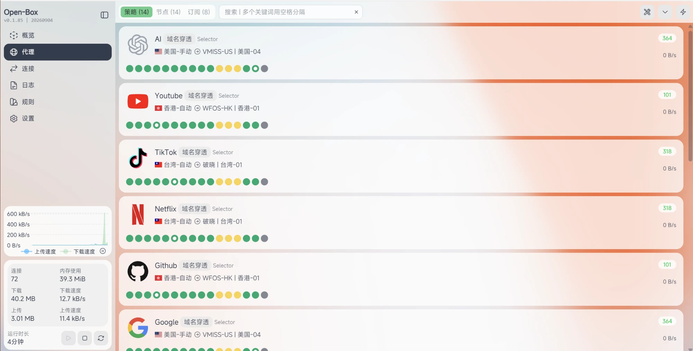
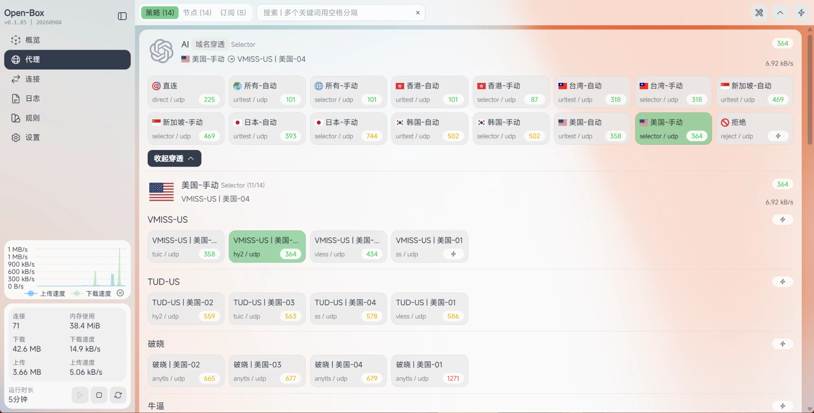
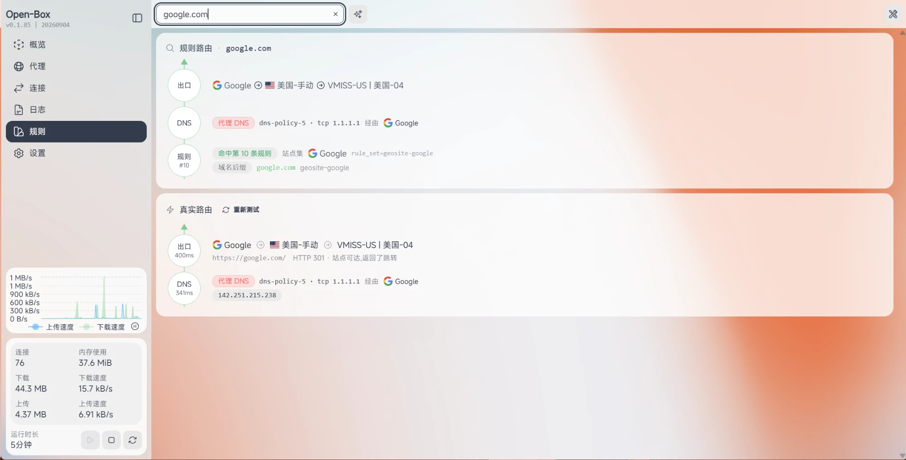
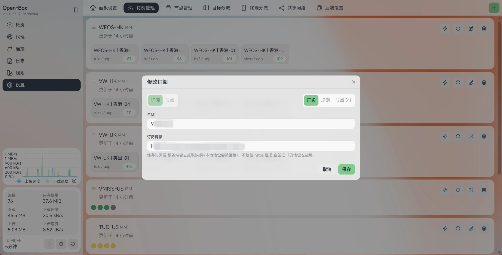
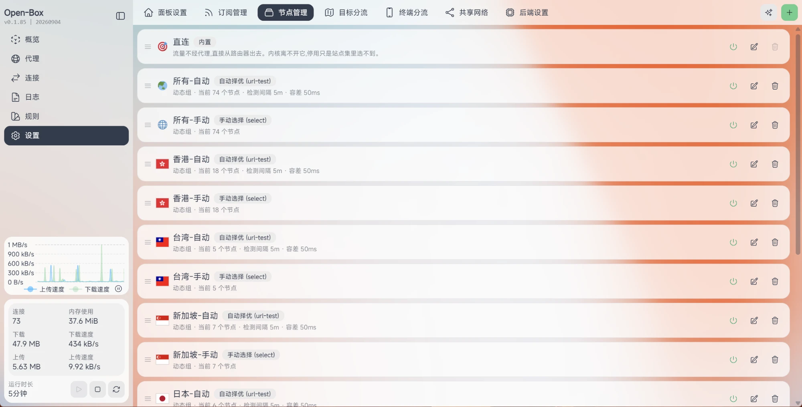
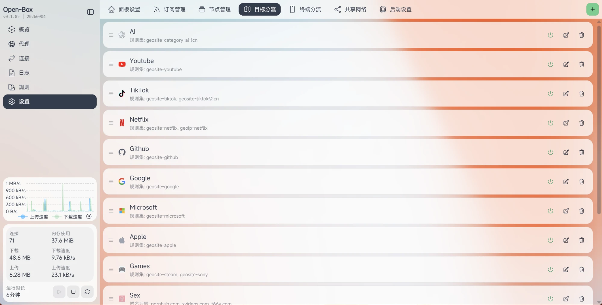
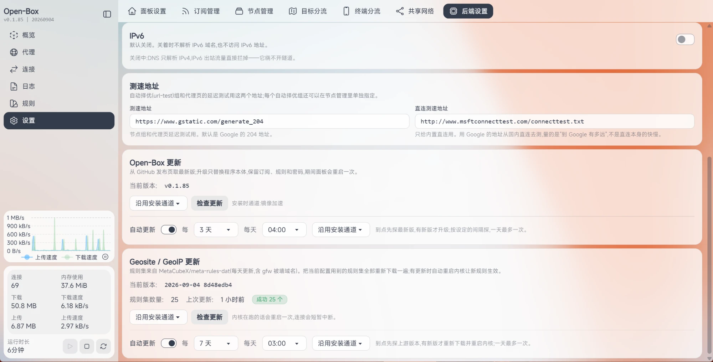

<picture>
  <source media="(prefers-color-scheme: dark)" srcset="docs/pic/logo-dark.png">
  
</picture>

Open-Box 分两部分：**路由器端**装在路由器 / 主机上，是一体化透明代理——安装包内置 Open-Box、sing-box 内核、Node 运行时以及完整 GeoSite / GeoIP 数据，安装后通过浏览器完成订阅、节点、分流、DNS 和防火墙设置，不需要手写配置文件；**客户端**是手机、电脑上的 Open-Box App，和家里的路由器端配对，在外面也按同一套规则分流。

**Open-Box 自有程序为闭源专有软件，并非开源项目。未经许可禁止复制传播自有代码、再分发、反编译及绕过授权。** 正常安装、离线使用、升级、备份和恢复允许；第三方开源组件保留原许可。详见 [LICENSE](LICENSE) 和 [版权范围](COPYRIGHT.md)。

**支持的平台**

路由器端（同一份安装包、同一条安装命令，脚本自己识别系统），见[路由器端](#路由器端)：

- **OpenWrt**（含 iStoreOS、ImmortalWrt 等衍生固件）：x86_64、aarch64；主路由或旁路由都行，带 LuCI 页面
- **Debian / Ubuntu**（需要 systemd；Ubuntu 24.04 验证过）：x86_64、aarch64；作为旁路由或只给本机用，没有 LuCI 和 dnsmasq 分流，见[安装](#安装)里的 Debian / Ubuntu 一节
- **Docker 旁路由**（Linux Docker Engine）：x86_64、aarch64；容器通过 macvlan / ipvlan L2 获取独立 LAN IP，支持一键安装、离线镜像和 `docker run`；新装默认端口 3036，升级保留原端口，见 [Docker 部署说明](docker/README.md)

客户端（Open-Box App，四个平台同一套界面和功能），见[客户端](#客户端)：

- **Android 手机**：Android 12 及以上、64 位 ARM，见[Android 客户端](#android-客户端)
- **macOS 电脑**：Apple 芯片（M1 及以后）、macOS 14 及以上，见[macOS 客户端](#macos-客户端)
- **Windows 电脑**：Windows 10 / 11 64 位，见[Windows 客户端](#windows-客户端)
- **Linux 电脑**：Ubuntu 22.04 / 24.04、Debian 12，64 位 x86，见[Linux 客户端](#linux-客户端)

## 使用说明视频

来自[安格视界 YouTube 频道](https://www.youtube.com/@Ange-Digital-Life/videos?hl=zh-CN)的操作演示，按发布先后。点链接会在当前页面打开，建议**右键「在新标签页中打开」**（或按住 Ctrl / ⌘ 再点）：

1. [最新软路由代理 Open-Box 发布！全图形极简配置，超越 OpenClash/Nikki/Passwall + SubStore + Zashboard？](https://youtu.be/G_7AmjfSRQ8)
2. [集成 ADGuard Home + 故障转移 + 解决 Google Play 无法下载，Open-Box 更新了啥？](https://youtu.be/fczlXs2t5tI)
3. [魔改 Sing-Box 1.14 内核，直连提速 200%！等同 Dae 性能，绝无 DNS 泄露 + 链式代理，Open-Box 完整体来了！](https://youtu.be/5_Z9d2zyzAw)
4. [Open-Box 客户端 Android 来啦！真一键配置 + 完美分流，绝无DNS泄露，是时候卸载 Karing/ClashMi 等其他代理 App 了](https://youtu.be/NVUssX8ILxE)
5. [Windows/macOS 来了，Open-Box 客户端，真一键配置 + 完美分流，绝无DNS泄露，生产力平台哪能缺席？](https://youtu.be/A1yFmwQLES4)
6. [Open-Box 客户端 Liunx 版上线，支持 Ubuntu/Debian，真一键配置，Android 端解决Google Play 下载问题/Geimini无网络问题，iOS 更新预告！](https://youtu.be/DfNwBbd3ECQ)
7. [网速提升10倍！ 提前杀死比赛？Open-Box 重构 负载均衡 + 带宽择优，Youtube 双 8K60帧无压](https://youtu.be/qQhOoUOWe70)
8. [之前更快，现在更稳！ 延时 x 带宽 x 抖动 + 业务择优 的  Open-Box 的大更新](https://youtu.be/_Y2VeP4fYkk)

## 推荐服务

- 优惠购买 AI 接口、机场、VPS、住宅 IP：[**安格超市**](https://blog.angeworld.cc/market)
- AI 中转站：[**SUPERDOOR 订阅服务**](https://ai.superdoor.top/)
- 按需付费 AI 服务：[**OPENDOOR**](https://ai.opendoor.sbs/)

## 路由器端

装在路由器 / 主机上的 Open-Box：浏览器里的面板加 sing-box 内核，给局域网里的设备分流。

### 界面

**概览**：四个测试站点的延时和最近几次的走势、连接 / 内存 / 流量的实时曲线、域名过滤统计和按月的流量洞察都在一页上。


**代理 · 策略**：每个站点集一张卡片，直接看到当前线路和节点健康状态。展开的成员列表接近可见区域时再加载，减少进入代理页时的卡顿，并保留展开状态。



**域名穿透**：展开策略后，可以看到站点集、节点组和具体节点的完整链路。



**规则 · 真实路由**：输入域名后可预览规则匹配结果，并实际发起请求查看线路、DNS 和命中规则。
「模拟终端」会在 LAN 网桥上临时挂一个带独立 MAC 的虚拟网口,像一台真实设备那样从入口进入路由器。ESXi 等虚拟化平台要把端口组安全策略的「混杂模式」设为接受,否则虚拟终端建不起来(面板会提示,不会悄悄退回内核诊断)。



**订阅管理**：支持 Clash YAML、base64 分享链接和常见 sing-box 分享链接；订阅分享区域可展开或收起，分享链接支持二维码、复制和启停。



**出站节点**：自动择优组和手动选择组可以混排，动态组会按关键词自动收编新节点，多个关键词用逗号分隔，可选 OR（命中任一）或 AND（全部命中）。

**带宽择优（路由器端）**：自动择优、故障转移和负载均衡可按组开启带宽择优，始终先排除故障及尚未确认恢复的节点。带宽测试周期和单次下载上限在后端统一设置，默认 2 小时、64 MB，同一实际节点跨组共用测试记录，并显示预计每日流量。点击开关旁的问号查看当前模式的选择规则和例子。客户端不启用带宽择优或下载测速；节点分流仍由路由器执行自身策略。



**目标分流**：站点集支持域名、域名后缀、关键词、IP 段、规则集和规则集链接等匹配方式。站点集从上往下匹配，先命中的算数。**IP 只管 IP，域名只管域名**，前置自定义分流和站点集都一样：有域名的访问只看域名条件，一个都没命中就走兜底「其他」，按「其他」的出口走，不会再拿解析出来的 IP 去对任何 IP 段、geoip；IP 条件只管直接按 IP 发起、内核也认不出域名的连接。这样 DNS 和连接永远走同一边：兜底直连的域名问直连 DNS、连接也直连；想让某个站点走节点，把它的域名加进对应站点集或前置自定义分流。内置的私网直连、订阅和节点站点直连不算分流，对所有连接生效。



**链式代理**：住宅 / 静态 IP 这类出口指定一个前置节点或节点组，编辑时就能测速、看出口 IP 和归属。


**后端设置**：IPv6、测速地址、内核服务和统一组件升级都在这里管理。自动测速会遵守每个策略配置的检测间隔；同一节点在间隔内复用已有结果，超时按策略立即重试或切换。



**手机上打开面板**：同一个面板，窄屏自动改成单列 / 两列布局，底部导航（手机上的 App 见[客户端](#客户端)）。

<p>
  
  
</p>

### 主要功能

- **DNS 重写目标可见**：连接、路由诊断和访问目标列表显示“原目标 → 重写目标”；`*.googleapis.cn → *.googleapis.com` 保留完整子域名前缀，根域需另建规则。

- **客户端配置独立保存**：选择哪份配置，就使用那份配置所属路由器同步的测试站点、测速地址、超时和延时颜色阈值；节点组沿用各自的检测间隔、容差和成功状态码。语言、主题、指定 Wi-Fi 暂停 VPN、按 App 分流等本机偏好也分别保存，切换配置不会借用另一份配置的设置。升级自动迁移原有偏好。
- **客户端直连 DNS**：在「设置 → 客户端」选择直连 DNS 使用当前网络（默认），或随配置使用路由器设置的直连 DNS；同步后生效。已同步配置和内容过滤快照可继续离线使用。
- **客户端配置同步**：仅在 VPN 完全未连接时允许同步；连接中、已连接和指定 Wi-Fi 暂停时同步图标置灰。断开后同步，再连接使新配置和内容规则生效。
- **内容过滤规则管理**：在「设置 → 客户端 → 内容过滤」管理规则、脚本快照和启停状态，内置「综合省流」「Youtube-Surge」「Youtube-补丁」三份默认快照。规则随配置同步到支持内容过滤的 iOS 客户端，由手机执行；离线可用，更新失败保留旧快照。升级保留已有规则及用户的编辑、停用和删除状态，备份恢复也包含规则与脚本。手机端仍需自行开启内容过滤并完成证书信任。
- **订阅与节点**：支持 Clash 配置、base64 节点分享和 shadowsocks、vmess、vless（含 REALITY）、trojan、hysteria2（含端口跳跃）、tuic、anytls、wireguard 等协议。也可在「登录」页填写支持 Xboard / V2Board 标准接口的站点 URL、UA、用户名和密码，获取节点、倍率、套餐和流量信息；重置日期和有效期以站点实际返回为准。密码不保存，更新时保持指定 UA。节点命名遵循 Open-Box 的重命名规则：有重命名时使用重命名，没有重命名时保留原名称。
- **节点组**：提供自动择优（url-test）、手动选择（select）和故障转移组；动态组按关键词跟随订阅更新，多个关键词用逗号分隔，可选 OR 命中任一或 AND 全部命中，留空代表全部节点（链式代理不进动态组，要用就加进静态组），静态组可以手工选择节点。故障转移组按主备页签排优先级：主用不通才切到备用，主用恢复再切回。 自动择优、失败复查与故障转移的检测结果按节点、测速网址及成功状态码分别记录；失败后保留 10 秒复查，避免不同检测目标互相影响。恢复切回须经新的成功检测确认，旧测速缓存不会触发切回。
- **链式代理**：给住宅 / 静态 IP 这类出口（socks5 / http / https，可粘链接或分字段填写）指定一个前置节点或节点组，流量先经前置再到出口；建好后作为普通节点用在节点组、站点集和终端分流里。
- **目标分流**：规则可以直接填写，也可以添加规则集链接。规则集链接和本地规则明细可以同时保留、同时生效，不会因为导入明细而删除原有链接。规则集链接每 24 小时随内核启动更新一次，链接旁的「立即更新」可以马上重拉，内核自动加载新内容。
- **切换不重启内核**：站点集在直连和代理之间切换时只改写一份很小的「开关规则集」，内核不重启——已建立的连接不断（下载、视频、SSH 不受影响），新连接和 DNS 在 1 秒内按新线路走。只有设备没有 nftables 重定向（纯 tun）、切换又牵动入口旁路，或者分流设置改过还没重启内核时，才会自动重新部署并重启一次。
- **TUN 参数**：后端设置里可改 tun 的协议栈（mixed / gvisor / system）、MTU 和内核自己发出的 TCP 连接的 MSS 钳制。MT6000 这类开着硬件流量卸载的机器有线口直连大文件损坏时，协议栈选 gvisor。
- **屏蔽 QUIC**：后端设置里的开关（默认开）。走代理线路的 QUIC（UDP 443）被拒绝，浏览器自动退回 TCP；直连的站点不受影响。不少节点转发 UDP 很差，YouTube 等走 QUIC 反而卡，所以默认开着；节点 UDP 很好的可以关掉。
- **规则集导入**：在站点集编辑窗口点击“导入规则”，输入规则列表地址后可以先预览解析结果，再把域名、域名后缀、关键词、IP/CIDR 等明细导入站点集。导入后的明细保存在本地，启动时不再依赖该远程规则链接。
- **订阅分享**：可以选择要分享的节点，设置标题和域名/IP，协议前缀支持 HTTP 或 HTTPS；保存一次即可生成并关闭窗口。分享列表支持展开/收起，单条分享可以启用或停用，也可以复制链接、刷新和删除。
- **DNS 接管**：支持接管 dnsmasq 转发、防火墙劫持和禁用三种模式，国内域名与代理域名可以分别解析。DNS 页先选路由器在「中国大陆」还是「中国大陆之外」（香港、澳门、台湾都属于「中国大陆之外」；新装、升级和点「恢复默认」时按出口公网 IP 自动判断，也可以手动切换），两侧上游可改地址和协议（UDP / TCP），也可以选「上游 DNS」（路由器接口上 DHCP 分配或手动指定的 DNS）：「直连 DNS」给直连域名用，默认是上游 DNS；「代理 DNS」给走代理的域名用，在中国大陆默认 TCP 1.1.1.1、不能用上游 DNS（中国大陆的 DNS 对境外域名有污染），在中国大陆之外默认上游 DNS。代理 DNS 走哪条线路由目标分流按它的地址决定，和局域网设备访问这个地址一样（比如 1.1.1.1 落在「国外」里，就走「国外」此刻选的线路）；上游 DNS 固定直连。哪个域名用哪个上游由站点集此刻的出口决定，不用单独配置；要把某个域名固定成某个 IP 或另一个域名，用「DNS 重写」。开着域名过滤时，「域名解析查询」逐条列出查询和发起的终端设备（IP 加名称）；dnsmasq 模式下终端从 dnsmasq 的查询日志里认（日志写在内存里、面板边读边清，不进 logread），dnsmasq 用缓存直接答掉的查询也会记下来。
- **入口旁路**：后端设置里的「直连不进内核」开关（默认开）管着整套；关掉后所有流量进内核，连接页和流量统计才能看到直连流量，代价是直连也要过一遍内核转发。开着时两种模式自动选，不用配置。**默认放行**（FakeIP 开着、兜底走直连时）：走代理的域名拿到的是占位地址、一定进内核，其余目标只要解析到的地址不在「进内核」名单（走代理 / 拒绝的站点集的 IP 集合）里，就在系统入口（nftables）直接放行——兜底直连、按域名直连的目标都不再经过内核。**默认进内核**（其余情况）：只有此刻走直连的站点集里的 IP 集合（默认「国内」的 geoip-cn 等）在入口放行，和走代理的集合有重叠的段会扣掉再放。两种模式之间、直连 / 代理翻面，都只改写几份规则集文件，内核不重启。此刻是哪种模式、为什么，规则页「业务入口」那一步写着。**直连应答放行**（默认放行模式下）：入口只看得到 IP，挂在 Cloudflare 这类 CDN 上的直连站（比如测速站、走兜底直连的网站）的地址落在走代理的集合里，入口分不出域名。内核在把直连站点集和兜底直连的 DNS 应答交给终端之前，先把其中会被送进内核的地址写进一个带超时的入口放行集合，终端拿到地址时连接已经在入口直接放走，第一条连接也不进内核。放行的地址按 DNS 应答的缓存时间保留（至少 15 分钟、最多一天）；重启内核时存下来，起来后按剩余时间写回去。终端分流里被指定走代理 / 拒绝的终端不参与这套放行：入口先按它们的来源跳过所有放行规则，它们的全部流量仍进内核。把站点集从直连切到代理 / 拒绝、或者改过分流设置时整个清空重来（连同 dnsmasq 的缓存），从代理切回直连时只删掉不再需要放行的地址。在「连接」页关掉一条连接、或者重启内核，会顺带清掉系统里这条连接的跟踪记录，卡在内核里的 UDP 长连接会按当前规则重新判定。**直连终端**：终端分流里给某台终端选了「直连」时，它的新连接的第一个包由内核按规则预判，不命中前置自定义分流里走代理 / 拒绝的 IP 段、规则集、端口，就在入口放行、整条连接不进内核（本来就不进内核的连接不预判，多宽带选线不受影响）；它的 DNS 查询也交给内核按这台终端答，拿到的是直连解析的真实地址，dnsmasq 模式下同样如此。选了「不进内核」的终端也按终端答 DNS，万一拿到 FakeIP 占位地址，连接照常进内核，不会连不上。「订阅和节点站点直连」里的节点服务器地址同样按首包预判在入口放行，局域网设备直连节点服务器不经过内核。默认放行模式的边界：把一个站点集从直连切到代理后，终端本地 DNS 缓存里还没过期的真实 IP 仍会按直连走；终端自带 DoH、开 FakeIP 之前缓存的真实 IP 同样不在保证内。
- **共享网络**：可以把内核入站开放给局域网中的其它设备作为代理使用。
- **终端分流与 IPv6**：给单个 IPv4 终端指定出站时，路由器能确认设备的 MAC 地址，就会让该设备的 IPv6 地址使用同一终端规则。IPv6 统一遵守后端全局设置；无法确认设备身份时不推断，网段规则仍只匹配各自的地址族。按 MAC 分流时，防火墙劫持模式的 DNS 也保留终端身份，支持 auto_redirect 和纯 TUN。
- **导出与导入**：把分流、站点集、节点组、DNS、面板设置打成一个文件，可选带上订阅和节点、链式代理、终端分流、共享网络；新设备导入后重启内核即可。文件不含面板密码。
- **流量统计**：按终端设备、节点和访问目标查看每日流量。
- **内容过滤规则恢复**：在「客户端 → 内容过滤」点击“恢复默认”，可离线恢复三份内置规则；保留用户自己添加的规则，恢复后在手机端同步。
- **内置规则数据库**：完整安装包自带 GeoSite / GeoIP 数据，首次安装和启动无需单独下载规则数据库。 v0.1.368 已核对并同步 2026-10-26 UTC 的数据（1,924 份 GeoSite、260 份 GeoIP），支持按简体中文、繁体中文和英文说明搜索。
- **组件升级**：Open-Box 程序、sing-box 内核和 GeoSite / GeoIP 数据统一从本仓库 Release 获取。升级前会校验本地版本和文件完整性，版本一致且文件正常时不会重复下载；完整安装包始终包含三类组件，新安装无需另行下载规则数据库。
- **LuCI 兜底页**：面板打不开时，可以从路由器的“服务 → Open-Box”页面启停服务、恢复直连或卸载。

### 下载

请从 [GitHub Releases](https://github.com/liandu2024/Open-Box/releases/latest) 下载对应架构的完整安装包：

- `x64`：x86_64 路由器 / 主机
- `arm64`：aarch64 路由器 / 主机

客户端的安装包见[客户端](#客户端)。

同一份安装包既能装在 OpenWrt 上，也能装在 Debian / Ubuntu（systemd）上，安装脚本会自行识别（见[安装](#安装)末尾）。

完整安装包包含 Open-Box、sing-box、Node 运行时和全部 GeoSite / GeoIP 数据。每个资产旁边都有 SHA256 校验文件。

作为旁路由使用（把终端的网关 / DNS 指向 Open-Box 所在设备）时，旁路由的 LAN 区域要打开「IP 动态伪装」（MASQUERADE），否则直连站点的回包不经旁路由、连接对不上，表现为只能上国外、打不开大陆网站。

### 安装

SSH 以 root 登录 OpenWrt 路由器后执行：

```sh
curl -fsSL https://raw.githubusercontent.com/liandu2024/Open-Box/main/scripts/install.sh | sh
```

GitHub 访问不畅时，需要先通过可访问的 raw 镜像获取安装脚本，再让脚本使用镜像下载发布包：

```sh
curl -fsSL https://gh-proxy.com/raw.githubusercontent.com/liandu2024/Open-Box/main/scripts/install.sh | sh -s -- --mirror
```

`--mirror` 只控制安装包下载；如果最外层的 `raw.githubusercontent.com` 本身无法访问，直接在原地址后追加 `--mirror` 仍然无法取得脚本。

安装过程中会问一次面板端口（默认 **3036**，直接回车即可）。端口会先检查是否可用——被别的程序占用、或与 Open-Box 自己和系统的端口冲突时，会说明原因并让你重填。也可以用 `--port` 直接指定，例如在上面的命令末尾加 ` --port 3080`。装完之后还能改，见[修改面板端口](#修改面板端口)。

安装要求：OpenWrt（iStoreOS 22.03、OpenWrt 22.03 及更早的固件太老装不了，请先升级到 iStoreOS 24 / OpenWrt 24 以上）、x86_64 或 aarch64、至少 512MB 存储空间和 512MB 内存。安装 / 升级脚本会检查并尝试用 opkg 或 apk 补齐系统依赖（kmod-tun、kmod-nft-queue、kmod-nft-nat、kmod-veth、ip-full、ca-bundle）；软件源不通时只提示、不中断，可稍后按提示手动安装，设 `OPENBOX_SKIP_DEPS=1` 可跳过这一步。安装完成后，用浏览器打开脚本提示的 `http://<路由器局域网 IP>:<面板端口>` 地址，首次访问设置管理密码。

安装完成后，用浏览器打开 `http://<路由器 LAN 地址>:<面板端口>`（安装脚本结束时会打印这个地址），**首次打开时设置面板密码**。以后忘了密码不用重装，见下面的[忘记面板密码](#忘记面板密码)。

#### Debian / Ubuntu

同样的安装、升级、卸载命令也适用于 Debian / Ubuntu（需要 systemd；在 Ubuntu 24.04 上验证过），以 root 或 `sudo` 执行即可。脚本会识别系统：服务交给 systemd（`openbox.service` 内核、`openbox-panel.service` 面板），命令行 `open-box` 放在 `/usr/local/bin`，随包的 Node 是 OpenWrt 用的 musl 版，安装时会从 nodejs.org（不通时换 npmmirror）下载同版本的官方 glibc 版替换，所以安装机器要能访问其中之一。依赖用 apt 补齐（nftables、xz-utils、iproute2、ca-certificates），tun / nftables 内核模块随发行版内核自带。

和 OpenWrt 的差别：

- 没有 LuCI 页面，也没有 dnsmasq 分流模式——DNS 只有「防火墙劫持」和「关闭」两种；本机用 systemd-resolved 的话它的上游查询同样会被内核接管，不需要改 resolved 的配置。
- 防火墙由你自己管理：脚本不会写任何放行规则。装了 ufw / firewalld 之类的话，要自己放行面板端口，以及（作为旁路由时）局域网到本机的转发。
- 面板以 root 运行、使用 HTTP，密码保存在本机数据库里（便于 root 找回）。**不要把面板端口暴露到公网**；需要远程访问时请走 VPN、SSH 隧道或带 TLS 的反向代理，并限制来源地址。
- 内核启动时会打开 IP 转发（`net.ipv4.ip_forward=1`，原来关着的话停止时关回去），这样局域网终端把网关 / DNS 指向这台机器就能走它分流；只给本机用的话不用管。
- 排障看 `journalctl -u openbox -u openbox-panel`；紧急恢复直连 `systemctl stop openbox`。

### 修改面板端口

新装的默认端口是 **3036**；**v0.1.216 及更早装的机器升级后端口不变**（还是 2026），不会被新默认值挪走。

两种改法，效果一样：

- **LuCI 页面**：路由器管理界面 → 服务 → Open-Box，「Open-Box 面板」那张卡片的按钮排末尾点「修改端口」。填新端口保存即可；有冲突不会保存并告诉你原因，面板正在运行的话会自动重启一次。
- **SSH**：`open-box port` 看当前端口，`open-box port 3080` 改成 3080。

改完记得用新地址访问面板。

### 忘记面板密码

面板密码保存在路由器上，能以 root 登上路由器就能查到，**不需要重装，也不会丢失订阅和规则**。两个地方可以看：

**1. LuCI 页面**：路由器管理界面 → 服务 → Open-Box，页面顶部「完整管理请到 Open-Box 面板：」那一行，面板地址后面直接显示 `密码: xxxx`。刚升级完看不到的话，退出 LuCI 重新登录一次。

**2. SSH 命令**：SSH 登上路由器后运行 `open-box`，选 `1`：

```text
root@OpenWrt:~# open-box

Open-Box v0.1.216
  1) 当前密码
  2) 重新启动
  3) 检查升级
  4) 卸载
  5) 退出
请选择 [1-5]: 1

  面板地址: http://192.168.1.1:3036
  当前密码: ********
```

只想要密码本身可以直接运行 `open-box password`；`open-box check` 检查有没有新版本，`open-box update` 直接升级，`open-box restart` 重启内核和面板，`open-box uninstall` 卸载。

以上两个入口从 **v0.1.210** 开始提供。更早的版本先通过 SSH 执行下面「升级」一节的命令升到最新版（升级会保留密码、订阅和规则），升级完成后 `open-box` 命令就可以用了。

查到密码后想换一个：登录面板，在「设置」页点「修改密码」。

### 升级

面板中可以从“设置 → 后端设置”检查更新，也可以通过 SSH 执行（OpenWrt 与 Debian / Ubuntu 同一条命令）：

```sh
curl -fsSL https://raw.githubusercontent.com/liandu2024/Open-Box/main/scripts/update.sh | sh
```

升级会保留订阅、规则和面板密码，并校验 Open-Box、sing-box、GeoSite / GeoIP 组件。相同且完整的组件直接复用，只有变化、缺失或损坏的组件才会从本仓库 Release 下载。

#### 回退到上一个版本

如果升级后面板或内核异常,可以用下面的命令回退:脚本会到 GitHub 查当前版本之前最近的正式 Release,重新下载那一版的完整安装包装回去。路由器本机不保留旧版备份,所以回退需要能访问 GitHub(或镜像);订阅、规则、面板密码等数据目录不会被动。

```sh
curl -fsSL https://raw.githubusercontent.com/liandu2024/Open-Box/main/scripts/update.sh | sh -s -- --rollback --direct
```

GitHub 访问不畅时，使用代理执行：

```sh
curl -fsSL https://gh-proxy.com/raw.githubusercontent.com/liandu2024/Open-Box/main/scripts/update.sh | sh -s -- --rollback --mirror https://gh-proxy.com
```

两条命令都会自动识别路由器架构,下载上一个版本的完整安装包,先校验 SHA256,再替换当前文件;校验或替换失败会保留现有安装。--mirror 只影响安装包下载,查询 Release 列表的 GitHub API 会先直连、直连不通再经镜像。

### 卸载

默认停止服务并保留订阅和配置数据：

```sh
curl -fsSL https://raw.githubusercontent.com/liandu2024/Open-Box/main/scripts/uninstall.sh | sh
```

连数据一起删除：

```sh
curl -fsSL https://raw.githubusercontent.com/liandu2024/Open-Box/main/scripts/uninstall.sh | sh -s -- --purge
```

## 客户端

Open-Box App 把家里路由器端的分流规则带到手机、电脑上：在外面也按同一套规则分流，App 里的内核和路由器端是同一个 sing-box。Android、macOS、Windows、Linux 四个平台同一套界面和功能：

- **节点分流**：在面板「设置 → 客户端」的「节点分流（客户端）」里扫共享网络服务器的码（电脑上粘贴链接），再输入面板上显示的 4 位配对码。App 按所在地区选一组规则（「地区分流」，可以自动定位），国内网站本地直连，其余经家里的路由器出去；路由器要有公网 IP。
- **本地分流**：扫面板「本地分流（客户端）」的码（电脑上粘贴链接），或导入那里导出的文件，再输入面板上显示的 4 位配对码。路由器的订阅节点、节点组、目标分流、链式代理整套导进 App，App 自己分流、不经过路由器；路由器上改了配置，在 App 里同步一下就跟上，同步时也会带回路由器当前的手动策略选择；订阅在 App 本机按计划刷新。
- **低密度二维码**：路由器和客户端升级到 0.1.352 后，节点分流像本地分流一样使用紧凑配对码，节点名称和协议参数不会再让二维码变密。首次导入时客户端需能访问路由器面板；没有公网面板地址时，先连接路由器所在局域网。新客户端仍兼容旧二维码。
- **配对码**：每份配置（每台共享网络服务器、本地分流）各有一个配对码，码或导出文件泄露了，别人没有配对码也导入不了。在面板二维码弹窗里可以更换配对码，换了以后之前导入的设备全部失效（节点分流同时更换这台服务器的密码），路由器与客户端升级到 0.1.350 后，点击客户端的同步按钮即可输入新配对码，验证通过后同步原配置并保留本机设置，无需重新扫码。旧节点配置升级后需要验证一次当前配对码。客户端 0.1.345 起支持配对码导入。
- **和路由器一样的分流**：选了直连的流量不进内核；「连接」页能看每条连接走哪条线路、看内核日志，「路由」页签输入网址就能看它按哪条规则走（规则路由）、实际访问时怎么走（真实路由）。
- **其他**：连上指定的 Wi-Fi（比如到家后）自动暂停 VPN、IPv6 开关、简体 / 繁體 / English、亮色 / 深色主题。

安装包都在 [Releases](https://github.com/liandu2024/Open-Box/releases)：`open-box-android-<版本>.apk`、`open-box-macos-<版本>-arm64.dmg`、`open-box-windows-<版本>-x64-setup.exe`、`open-box-desktop-linux-<版本>-amd64.deb`，也可以在面板「设置 → 客户端」最上面的「客户端下载」里直接点。客户端只在有更新时随版本发布；最新版没带的话，它的版本说明末尾「客户端下载」一节有最新安装包的链接，也可以在 Releases 列表里往前找。

客户端「设置 → 配置」中，检测到配对失效或配对码已更换时，配置名称右侧会显示红色「！」。点击可查看原因并同步，输入正确的新配对码、同步成功后警告自动消失；本地分流和节点分流都支持。

0.1.361 修复了订阅导入时丢失 TUIC / Hysteria2 证书指纹、WireGuard 预共享密钥及 MTU 的问题。路由器与客户端请同步更新；升级后刷新对应订阅，补回旧节点记录中已丢失的参数。使用证书指纹的节点仍会校验证书身份，指纹不匹配时拒绝连接。

### Android 客户端

- **系统要求**：Android 12 及以上、64 位 ARM。
- **安装与升级**：从 [Releases](https://github.com/liandu2024/Open-Box/releases) 下载最新的 `open-box-android-<版本>.apk`（或在面板「设置 → 客户端」的「客户端下载」里点 Android 图标），第一次手动安装（系统会提示允许安装来自浏览器 / 文件管理器的应用）；以后在 App「设置 → 检查更新」里一键升级。

首页（节点分流）、代理 · 策略（本地分流）、连接 · 路由、设置：

<p>
  
  
</p>
<p>
  
  
</p>

### macOS 客户端

App 常驻菜单栏，退出 App 就断开 VPN；设置里有开机自启开关（默认关）。

- **系统要求**：Apple 芯片（M1 及以后）的 Mac，macOS 14 及以上。
- **安装**：从 [Releases](https://github.com/liandu2024/Open-Box/releases) 下载最新的 `open-box-macos-<版本>-arm64.dmg`（或在面板「设置 → 客户端」的「客户端下载」里点 macOS 图标），打开后把 Open-Box 拖进「应用程序」。App 没有 Apple 开发者签名，第一次打开会提示无法验证：到「系统设置 → 隐私与安全性」最下面点「仍要打开」（macOS 15 起右键「打开」已经绕不过去）。第一次打开还会请你输一次电脑密码，装一个后台服务（建立 VPN、修改系统 DNS 用，断开后自动还原）。
- **升级**：在 App「设置 → 检查更新」里一键升级，不用再点「仍要打开」；后台服务有变化时会再请你输一次电脑密码。
- **卸载**：App「设置 → 卸载 Open-Box」。
- 「连接指定 Wi-Fi 暂停」要允许 App 使用位置信息（macOS 只把 Wi-Fi 名称给有定位权限的 App）。

首页（节点分流）、代理 · 策略（本地分流）、连接 · 路由、设置：

<p>
  
  
</p>
<p>
  
  
</p>

### Windows 客户端

App 常驻任务栏右下角：关掉窗口还在后台，左键点图标打开窗口，右键菜单里可以连接 / 断开、退出；退出 App 就断开 VPN。设置里有开机自启开关（默认关）。

- **系统要求**：Windows 10 / 11，64 位。
- **安装**：从 [Releases](https://github.com/liandu2024/Open-Box/releases) 下载最新的 `open-box-windows-<版本>-x64-setup.exe`（或在面板「设置 → 客户端」的「客户端下载」里点 Windows 图标），双击安装。安装包没有代码签名，运行时会提示「Windows 已保护你的电脑」：点「更多信息 → 仍要运行」，再在用户账户控制里点「是」。安装时会装一个后台服务（建立 VPN 用）。
- **升级**：在 App「设置 → 检查更新」里一键升级：用户账户控制里点一次「是」，装好后 App 自动重新打开。
- **卸载**：App「设置 → 卸载 Open-Box」，或在 Windows「设置 → 应用 → 已安装的应用」里卸载 Open-Box。
- 「连接指定 Wi-Fi 暂停」在 Windows 11 24H2 及以后要在「设置 → 隐私和安全性 → 位置」里打开定位服务、允许桌面应用访问位置（Windows 只把 Wi-Fi 名称给有定位权限的应用）。

首页（节点分流）、代理 · 策略（本地分流）、连接 · 路由、设置：

<p>
  
  
</p>
<p>
  
  
</p>

### Linux 客户端

关掉窗口 App 还在后台，顶栏托盘图标的菜单里可以打开窗口、连接 / 断开、退出；退出 App 就断开 VPN。设置里有开机自启开关（默认关）。

- **系统要求**：Ubuntu 22.04 / 24.04、Debian 12，64 位 x86（amd64），GNOME 或 KDE 桌面。GNOME 要有 AppIndicator 扩展才显示托盘图标（Ubuntu 自带；Debian 要装 `gnome-shell-extension-appindicator`），没有托盘时从应用列表再打开 Open-Box 就回到窗口。
- **安装**：从 [Releases](https://github.com/liandu2024/Open-Box/releases) 下载最新的 `open-box-desktop-linux-<版本>-amd64.deb`（或在面板「设置 → 客户端」的「客户端下载」里点 Linux 图标），在下载目录里运行 `sudo apt install ./open-box-desktop-linux-<版本>-amd64.deb`，装好后在应用列表里打开 Open-Box。安装时会装一个后台服务（建立 VPN、接管系统 DNS 用，断开后自动还原）。
- **升级**：在 App「设置 → 检查更新」里一键升级，不用输密码，装好后 App 自动重新打开。
- **卸载**：App「设置 → 卸载 Open-Box」，或运行 `sudo apt purge open-box-desktop`。
- 同一台电脑上装着路由器端 Open-Box（Debian / Ubuntu 版）、而且它的内核在跑时，App 不会连接，要先在它的面板里停止内核。

首页（节点分流）、代理 · 策略（本地分流）、连接 · 路由、设置：

<p>
  
  
</p>
<p>
  
  
</p>

## 许可证

本仓库公开安装、升级、卸载及 Docker 部署所需脚本、使用文档和官方发行版。Open-Box 自有程序适用根目录 [LICENSE](LICENSE)，未经许可禁止复制传播、再分发、反编译、制作换名衍生产品及绕过授权。上游 zashboard 的 MIT 代码、sing-box 内核及其他第三方组件继续遵守各自开源许可证；许可范围及历史许可说明见 [COPYRIGHT.md](COPYRIGHT.md)。

## Star 增长

<a href="https://www.star-history.com/#liandu2024/open-box&Date">
  <picture>
    <source media="(prefers-color-scheme: dark)" srcset="https://api.star-history.com/svg?repos=liandu2024/open-box&type=Date&theme=dark" />
    <source media="(prefers-color-scheme: light)" srcset="https://api.star-history.com/svg?repos=liandu2024/open-box&type=Date" />
    
  </picture>
</a>
